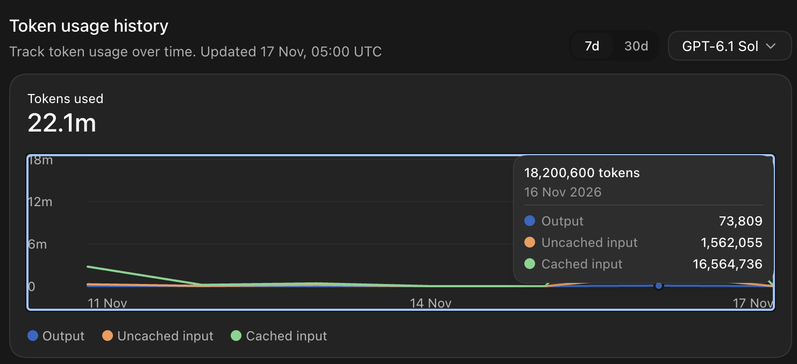

# StudentCare: Project overview

## 1. Purpose: helping students get from care to claim

StudentCare is a prototype assistant for NUS students like myself who face questions and issues when it comes to care on campus and university insurance claims. Its purpose is to make the administrative side of seeking care and preparing an insurance claim easier to understand.

A student might ask: “I visited a specialist. What should I do next?” The answer may depend on their student category, the date of care, the kind of visit, and the conditions in the university’s insurance documents. Those details are spread across policy overviews, factsheets, claim instructions and facility information.

The problem is more than finding a paragraph in a PDF. Students need to connect information across documents and turn it into practical steps: where to access care, which administrative route may apply, what paperwork to keep, and how to prepare a claim. Missing a condition or using the wrong claim route can create confusion and extra work.

StudentCare combines the student’s profile and concern with the supplied reference documents, then presents a short, organized answer with sources. Its two entry points are **Help with care** and **Help with claim**.

It does NOT diagnose symptoms, recommend treatment, assess medical urgency, or decide whether an insurer will pay a claim.

## 2. How this differs from asking a generic LLM

A generic LLM can also read uploaded PDFs and produce a good answer. StudentCare’s potential value comes from making that capability part of a focused, repeatable student workflow.

| A general chat workflow | StudentCare’s approach |
| --- | --- |
| The student must explain their university and relevant background each time. | A small profile form captures the student categories used by the references. |
| The student must find and attach the right documents. | The supplied NUS reference set is already available to the model. |
| The answer format depends on the prompt. | The interface expects clear next steps, document conditions and source links. |
| The student must check whether citations actually exist. | The server checks the cited document, page and quoted text automatically. |
| Care access and claims may become separate conversations. | The interface supports moving from care guidance to claim preparation with the same profile. |

This is not a guarantee of better reasoning, so a carefully prompted general model with the same documents could produce similar wording. The main product direction is to consistently reduce the effort needed to find the right information, understand conditions and prepare the next actions.

## Coding agent and prompting:

```Agent: OpenAI Codex
Model: GPT 6.1 Sol (started with Light, moved to Medium for main coding)
Context: Project directory (which is also the git repo)
Mode: Desktop app for major prompts, CLI for small questions
```
Usage statistics:
I couldn't find per-project statistics, so around 90% of the tokens on Nov 16th can be estimated as spent on this project.




For a subscription, out of pocket cost for this is 0. API-based usage cost would be around $4.5.

### A summary of prompts

1. Initialisation prompt: 
<details>
<summary>Full prompt</summary>

I want to build an application (prototype) for a student health insurance assistant. Call it StudentCare, a NUS-specific assistant that takes in student's concerns, then explains where students can seek care, what their university policy suggests, and what documents they need for a claim. It should guide them through the process from care to claim.

The app should have the following capabilities:
- Take input and store (in-memory for now) student profile with University name, Enrolment year, graduate/undergraduate, local/international, full-time/part-time student, and any more information needed for checking policy documents.
- Give an option of Need help with Care v/s Need help with Claim. In either case, take in natural language input about the student's issues and use LLM API with grounding on si-docs documents.
- Provide care suggestions, docs needed and panel clinics/GPs for option 1, and provide a claim document checklist for the second. A stretch goal is adding personal document verification via images/PDF (strictly stretch goal).
- Output a relevant answer grounded in the reference documents, with no hallucination and no medical advice. The response should not contain any critical diagnostic info, and no assumptions about missing reference information.
- For the API, I have Google gemini API key.
This is just a prototype, I want it to be fast and lighweight.

Prepare a development plan for this, create a AGENTS.md and README.md.

</details>

- State the problem, the expected capabilities of the app at high-level, and ask for a development plan along with `AGENTS.md`.
- Give the reference PDFs folder as context
- Skill used internally: `senior-fullstack` from Claude-skills
- Output: Markdowns for dev plan, `AGENTS.md` and `README.md`
- Review: Plan looked good, made a few changes as needed.
- Added Gemini API Key and Model to `.env.local` file, ready for use.

2. Next prompt for implementing the development plan:

<details>
<summary>Full prompt</summary>
Build the web app prototype according to the DEVELOPMENT_PLAN.md, and update README.md, AGENTS.md if needed. Some considerations:
- Use pastel green palette for UI, keep it simple with low cognitive load
- As you build, add unit tests
</details>

- State that Codex should follow the dev plan
- Update README and keep testing incremental changes
- Changed the model to GPT 6.1 Sol Medium
- Output: A running Next.js application.
- Review: Tested it with different inputs, found issues with unnecessary information, strict rule-based item matching, Gemini API config (timeouts, token limits).

3. Refining the application: Troubleshooting with concrete examples
<details>
<summary>Example prompt</summary>
With this input:
{"mode":"claim","profile":{"university":"National University of Singapore","year":2026,"level":"graduate","residency":"international","attendance":"full-time","status":"active","fees":"paid"},"concern":"I visited ENT specialist","date":"2026-11-16","setting":"specialist","log":"unknown","consent":true}

Guidance api returns is the output:
{
"status": "invalid_model_response",
"message": "Gemini returned an unreadable guidance selection. Please try again.",
"items": [],
"engine": "gemini",
"limitations": []
}

Explain what's happening here? Improve error handling and observability of different status codes.
</details> 

- Identified issues with error observability, asked to improve propagation of exact error through the API call.
- Supplied actual request payloads, API responses, and logs when valid inputs failed.
- Output: Code fixes for the issues, simultaneous updates to README, AGENTS and test cases.

4. Review and architectural refinement: 
<details>
<summary>Example prompt</summary>
Remove the limitation of responding only using the rule-Ids and their wording. I want the LLM to have context of all the PDFs or rules, and let it decide the most relevant-to-student's-concern parts of the PDF, and then respond with the next steps in its words, with a well-arranged answer.
Make the relevant changes to all files.
</details> 

- Questioned unfamiliar fields, asked for a change from overly strict rule-based answer to full-PDF context and model-written answers with citations.
- Diagnostic requests were approval based, to prevent free Gemini quota from running out. 

5. Usability and maintainance:
<details>
<summary>Example prompt</summary>
Add a tooltip explaining the fields Health Service Fees and Care or claim type. Tooltip text should be very very brief.
</details> 

- Requested brief tooltips for “Health Service Fees” and “Care or claim type,” to make it clearer.
- Code-cleanup and documentation generation were final steps.

Total time taken actively: **3-3.5 hours.**


