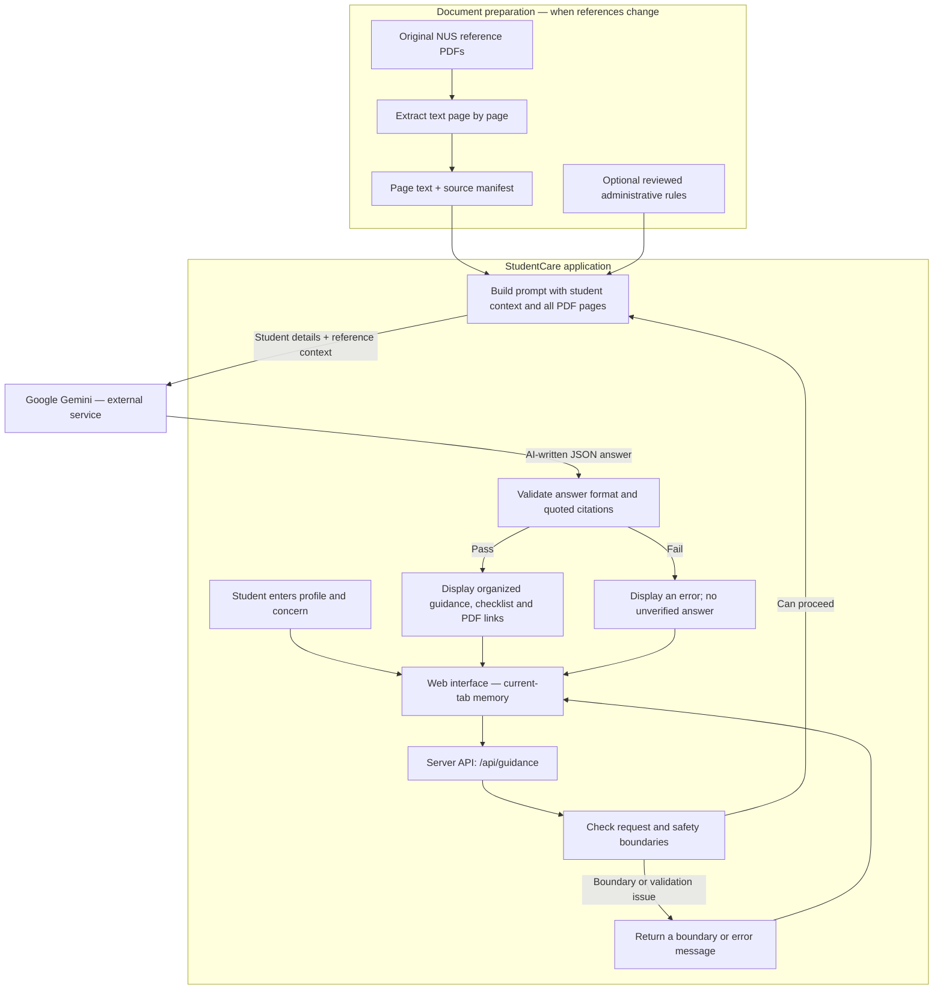

# StudentCare

A lightweight NUS student insurance prototype that provides cited, AI-written care and claim guidance from supplied university PDFs.

## Run locally

Use Node 24 (see `.nvmrc`).

```sh
npm ci
# Skip the copy if .env.local already exists.
cp .env.example .env.local
# Set GEMINI_API_KEY and GEMINI_MODEL in .env.local.
npm run docs:ingest
npm run dev
```

Open [StudentCare](http://localhost:3000). Choose a Gemini text model with JSON output and enough context for the complete corpus. Both environment variables are required; missing configuration shows setup instructions, with no fallback guidance. Keep keys server-side; never use a `NEXT_PUBLIC_` prefix.

## System architecture

The prototype is one Next.js application: the web interface and server API live in the same project. Google Gemini is the external model service (LLM API).



## Answer pipeline

1. `POST /api/guidance` validates input, consent, origin, size and a demo rate limit. Explicit immediate-help requests use a fixed response; medical requests and out-of-period dates receive boundary messages.
2. The official [`@google/genai` SDK](https://googleapis.github.io/js-genai/index.html) sends all extracted text from **ten PDFs (32 physical pages)**, the manifest and optional curated rules to Gemini. No PDF binaries, open-web lookup or category-based context filtering are used.
3. Gemini writes overview, care access, next steps and document items, each with a source ID, physical page and exact administrative quote. Unknown facts may lead to conditional guidance or questions.
4. Local checks validate answer structure, document/page existence, quote presence and checklist conditions. The UI renders escaped text, source links and interactive document checkboxes. API follow-up questions are currently not displayed.

JSON MIME mode is enabled; the answer format is supplied in the prompt, without a provider-enforced schema. Local Zod and citation validation remain mandatory.

### API response

```text
{
  status, message, engine,
  items: [{ id, section, title, text, requirement, condition,
            citations: [{ sourceId, page, quote }] }],
  questions: [], limitations: []
}
```

Answer statuses are `answered`, `needs_information` and `insufficient_evidence`. Operational errors distinguish configuration/provider failures, timeout, network failure, blocked/empty/truncated output, malformed answers and invalid citations. Responses do not expose raw provider errors.

## Code structure at a glance

| Location | What it does |
| --- | --- |
| `src/app/page.tsx` and `globals.css` | Student profile form, care/claim selection, tooltips, answer sections and checklist. |
| `src/app/api/guidance/route.ts` | Receives requests and applies input, origin, size and rate-limit checks. |
| `src/app/sources/[sourceId]/route.ts` | Opens an allowlisted original reference PDF. |
| `src/lib/gemini.ts` | Makes the server-side Gemini request. The API key stays here on the server side. |
| `src/lib/grounding.ts` | Builds the full reference context, defines model instructions and checks quoted evidence. |
| `src/lib/contracts.ts` and `guidance.ts` | Define the input/output shapes, coordinate the request and validate the generated answer. |
| `src/lib/policy.ts` | Handles the prototype’s direct safety and policy-date boundary checks. |
| Other `src/lib/` helpers | Configure generation budgets and classify provider, empty-response and truncation errors. |
| `si-docs/` | Original university and insurance reference PDFs. |
| `policy/` | Extracted page text, source metadata and optional administrative rules. |
| `scripts/` | Rebuild document data, maintain optional rules and run browser checks. |
| `tests/` | Test answer validation, citations, request handling and provider failures, mostly with mocked responses. |

## Limits and privacy

- **Citation checks establish provenance, not correct interpretation.** Human review and live answer evaluation are still needed. Extracted tables and flowcharts may lose layout; missing or conflicting evidence must remain explicit.
- Factsheets cover **1 August 2026–31 July 2027**; other effective periods may be unknown. Eligibility and reimbursement are never guaranteed. UHC is a labelled prototype option, not independently verified insurer membership; there is no live clinic directory.
- Administrative guidance only: no diagnosis, treatment advice, clinical triage, personal document uploads, reimbursement calculation, bookings or claim submission. The immediate-help pathway is a fixed safety exit, not a symptom classifier.
- Personal state stays in current-tab React memory, with no database or browser storage. Refresh/reset clears it; edits invalidate answers. Care-to-claim retains profile/category and requests actual claim details.
- Submitted concerns, profile/case details and static references go to Google. Use fictional data until provider terms are reviewed. Application logs exclude personal content and raw provider payloads; hosting must also avoid body logging. The proxy-header-based, process-local rate limiter is demo protection only.

## Development and validation

```sh
npm run test
npm run typecheck
npm run lint
npm run build
npm start
npm run docs:ingest
npm run format
```

Default tests mock provider calls and cover request boundaries, full-corpus context, answer contracts, citations, conditional documents and provider failures. They do not establish live answer accuracy, safety, latency, cost or uptime.

For browser smoke checks, start the development server and run `npm run test:browser`. Install Chromium with `npx playwright install chromium` or set `CHROME_PATH`. Checks use mocked answers and the static emergency pathway, without paid calls.

For policy updates, preserve originals in `si-docs/`, run `npm run docs:ingest`, and visually review affected tables, footnotes, flowcharts and effective dates. Update optional aids in `scripts/create-rules.py`, regenerate `policy/rules.json`, then test and review representative answers. `policy/manifest.json` stores hashes/page counts; `policy/generated/pages.json` stores page-addressable text. Ingestion does not certify extraction accuracy.

## Gemini configuration and troubleshooting

| Setting | Default | Accepted range / behavior |
| --- | --- | --- |
| `GEMINI_TIMEOUT_MS` | `60000` | 1000–120000 ms; invalid values use the default. Hosting limits also apply. |
| `GEMINI_MAX_OUTPUT_TOKENS` | `16384` | 2048–65536; the chosen model must support the value. |
| Thinking | Model-dependent | Gemini 3/4: low; Gemini 2.5: 1024-token budget; unknown families: omitted. |

Full-corpus context and higher output budgets can increase latency and cost. Thinking may consume the generation budget; partial/truncated answers are rejected without an automatic second paid request.

- **Timeout/network failures:** inspect safe `studentcare.gemini_failure` category/status/timing metadata. Increasing the timeout does not diagnose or fix network, quota or service failures. The route requests a 150-second hosting budget where supported.
- **HTTP errors:** do not add SDK `httpOptions.retryOptions`; the installed SDK's retry wrapper loses numeric status codes. Mocked HTTP tests verify error preservation through the real SDK.
- **Schema compatibility:** one approved fictional-data request reproduced HTTP 400 schema rejection. The adapter now uses prompt-based formatting; the corrected payload has mocked coverage but no second live verification.
- **Truncation:** `studentcare.gemini_truncated` logs counts/timings only. A larger token budget may help but does not guarantee completion.
- **Live diagnosis:** `npm run diagnose:gemini` makes one opt-in fictional-data request using `.env.local` and may consume quota. It prints safe outcome/category/timing metadata only.
- **Development HMR:** `localhost` and `127.0.0.1` are supported. Restart the dev server and refresh after config changes if hot reload fails; keep the development allowlist explicit.

### What a useful final product could become

A stronger product could maintain approved, dated university references; show which checklist items are conditional; and help a student prepare before contacting the insurer. A university could use it as a first admin help point, with clear routes to human support for unresolved cases.

## How local small language models could help

A **small language model (SLM)** could run on a student’s device or university hardware instead of cloud Gemini.

| Area | Benefit | Tradeoff |
| --- | --- | --- |
| **Privacy** | Keeps data away from external model providers. | Processing, logs and backups must also stay local. |
| **Latency** | Avoids network delays and provider queues. | Speed depends on hardware, model loading and document length. |
| **Cost** | Avoids per-request API charges. | Hardware and maintenance still cost money. |

Smaller models may struggle with complex policies and accurate citations. Retrieving only relevant PDF pages could reduce processing (vector DB).

## Stretch goal: document checks
A future version could compare uploaded receipts, invoices and referral letters with the claim checklist.

Consent and upload → extract text → check requirements → flag present, missing or unreadable information → student confirms.

See [DEVELOPMENT_PLAN.md](DEVELOPMENT_PLAN.md) for architecture and [AGENTS.md](AGENTS.md) for contributor requirements.
